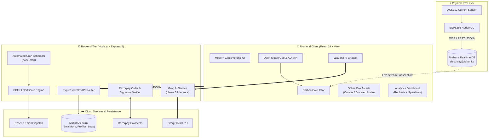
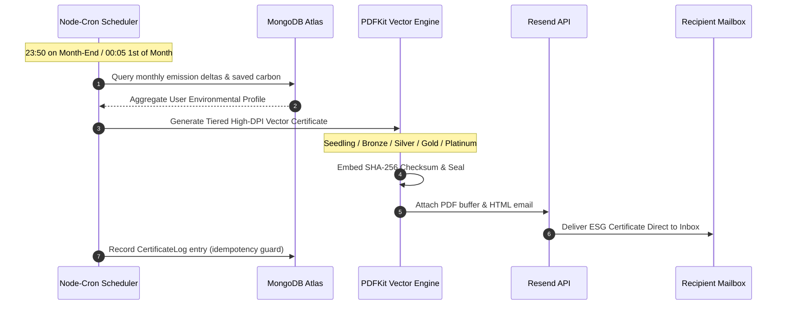

<div align="center">

# 🌍 VASUDHA (वसुधा • ವಸುಧಾ)
### *Next-Gen Environmental Intelligence, Carbon Auditing & Real-Time IoT Ecosystem*

[](https://react.dev/)
[](https://vitejs.dev/)
[](https://nodejs.org/)
[](https://www.mongodb.com/)
[](https://firebase.google.com/)
[](https://groq.com/)
[](https://razorpay.com/)
[](LICENSE)

<br/>

> *"Vasudha (वसुधा / ವಸುಧಾ) — Sanskrit for Mother Earth: Bridging the chasm between personal daily habits and planetary preservation through automated IoT telemetry, atmospheric intelligence, AI coaching, and verifiable ESG impact certification."*

<br/>

[✨ Key Innovations](#-key-innovations) •
[📐 System Architecture](#-system-architecture) •
[📊 Mathematical Models](#-scientific-emission-models) •
[🤖 Vasudha AI](#-vasudha-ai-assistant) •
[🎮 Eco Offline Arcade](#-fail-safe-offline-eco-runner) •
[⚡ IoT Hardware Integration](#-iot-smart-meter-integration) •
[📜 Automated ESG Certificates](#-automated-esg-certification-pipeline) •
[🚀 Quick Start](#-quick-start--installation) •
[📡 API Reference](#-rest-api-specification)

</div>

---

## 🧭 Executive Summary

**Vasudha** is an enterprise-grade full-stack climate intelligence and carbon mitigation platform. Going far beyond traditional manual carbon calculators, Vasudha pairs **real-time IoT hardware telemetry** (ESP8266 + ACS712 energy sensing) with **live atmospheric telemetry** (Open-Meteo US AQI & pollutant monitoring) to dynamically track, compute, visualize, and reduce residential and mobility carbon footprints.

Featuring the **Vasudha AI Assistant** powered by ultra-low-latency Groq inference, automated end-of-month vector PDF sustainability certificates, Razorpay-backed reforestation crowd-funding with instant 80G tax invoices, and a canvas-powered 60 FPS offline game that activates during network outages, Vasudha sets the benchmark for modern climate tech applications.

---

## ⚡ Core Matrix: Feature Highlights

| Feature | Engine / Tech | Purpose & Impact |
| :--- | :--- | :--- |
| **Multi-Vector Carbon Engine** | React 19 + Scientific Factors | Computes travel, diet, and electricity footprint with interactive radial SVG gauges. |
| **IoT Live Electricity Stream** | ESP8266 + Firebase RTDB | Real-time appliance energy consumption pushes directly to user carbon calculations. |
| **Live AQI & Geo Telemetry** | Open-Meteo Air Quality API | Instant US AQI, PM2.5, PM10, temperature, and UV indices with contextual health alerts. |
| **Vasudha Climate AI** | Groq AI LLM | Hyper-concise environmental advisor aware of your current local weather and air metrics. |
| **Living Grove Reforestation** | Razorpay + Dynamic SVG | ₹100 = 1 tree planted. Living SVG grove grows and blooms in real-time with firefly particles. |
| **Automated ESG PDF Engine** | PDFKit + Node-Cron + Resend | Auto-dispatches cryptographically hashed sustainability certificates to user emails on month-end. |
| **Offline Eco Runner 2D** | HTML5 Canvas + Web Audio API | Zero-downtime offline state: an arcade runner with power-ups, combo mechanics, and chiptunes. |
| **Interactive Analytics Hub** | Recharts + Custom Sparklines | 7-day emission trajectories, historical trends, category breakdowns, and tree equivalents. |

---

## ✨ Key Innovations

### 1. 🧮 Multi-Vector Carbon Footprint Engine
- **Granular Category Tracking**: Covers commute modes (Car, Bike, Bus, Train, EV, Walking), regional power consumption, and dietary profiles (Vegan to High Non-Veg).
- **Smooth Interpolated UX**: Eased animated count-up counters with custom cubic bezier curves (`1 - Math.pow(1 - p, 3)`).
- **Visual Severity Ring**: SVG-based dynamic circumference gauge mapping emissions up to 60 kg $\text{CO}_2\text{e}$/day with contextual color gradients.

### 2. 📡 Real-Time IoT Smart Energy Telemetry
- **Hardware Integration Ready**: Listens to `electricity/{userId}/units` over Firebase Realtime Database websocket subscriptions.
- **Automated Ingestion**: Live kWh readings from ESP8266 / NodeMCU microcontrollers stream directly into the calculation form without user intervention.

### 3. 🌫 Atmospheric Intelligence & Geocoding
- **Debounced Autocomplete**: City search with `AbortController` request cancellation to eliminate stale asynchronous network responses.
- **US AQI Metric Mapping**: Instant classification across 6 environmental tiers (Good, Moderate, Sensitive Groups, Unhealthy, Very Unhealthy, Hazardous) with actionable outdoor guidance.

### 4. 🤖 Vasudha AI Climate Assistant
- **Telemetry-Aware Inference**: The model prompt is pre-injected with live local weather, temperature, humidity, wind speed, UV index, and PM2.5/PM10 concentrations.
- **Rapid Action Prompts**: Interactive chip suggestions for instant carbon reduction hacks, public transit comparisons, and diet shifts.

### 5. 🌲 The Living Grove & Financial Transparency
- **Direct Climate Action**: Every ₹100 contribution finances one real-world planted tree absorbing ~21 kg $\text{CO}_2$ annually.
- **Procedural Animated Grove**: Dynamic SVG rendering where each planted tree incrementally populates the forest canvas with wandering fireflies.
- **Instant Tax Invoices**: Generates client-side formatted PDF donation receipts with legal invoice identifiers via jsPDF.

### 6. 🏆 Automated Month-End ESG Certification
- **Autonomous Cron Daemon**: Background worker (`node-cron`) inspects calendars at `23:50` on month-end and `00:05` on the 1st of the month.
- **Cryptographic Hash Verification**: PDF certificates include SHA-256 verification codes, medal seals (Seedling, Bronze, Silver, Gold, Platinum), and automated HTML delivery via Resend.

### 7. 🎮 Fail-Safe Offline Eco Arcade
- **Zero-Downtime Resilience**: Seamlessly intercepts network drops (`window.addEventListener('offline')`) and boots a full-featured 60 FPS HTML5 Canvas game.
- **Rich Arcade Mechanics**: Procedural obstacle generation, parallax cloud/ground layers, Web Audio API sound synthesizers, power-ups (*Shield*, *Coin Magnet*, *Slow-Motion*), combo multipliers, and persistent local high scores.

---

## 📐 System Architecture



---

## 📊 Scientific Emission Models

Vasudha calculates carbon equivalence based on globally recognized emissions factors and grid carbon intensities:

### 1. Daily Carbon Equation
$$\mathbf{E_{\text{total}}} = \mathbf{E_{\text{commute}}} + \mathbf{E_{\text{electricity}}} + \mathbf{E_{\text{diet}}}$$

Where:
* **Commute Emissions**:
  $$\mathbf{E_{\text{commute}}} = d \times F_{\text{mode}}$$
  * *Passenger Car*: $0.21 \text{ kg CO}_2\text{e / km}$
  * *Motorcycle / Scooter*: $0.05 \text{ kg CO}_2\text{e / km}$
  * *Public Bus*: $0.10 \text{ kg CO}_2\text{e / km}$
  * *Electric Train / Metro*: $0.04 \text{ kg CO}_2\text{e / km}$
  * *Electric Vehicle (EV)*: $0.03 \text{ kg CO}_2\text{e / km}$
  * *Walking / Cycling*: $0.00 \text{ kg CO}_2\text{e / km}$

* **Electricity Emissions**:
  $$\mathbf{E_{\text{electricity}}} = U \times 0.82 \text{ kg CO}_2\text{e / kWh}$$
  *(Calibrated to standard mixed-grid carbon intensity)*

* **Dietary Footprint**:
  * *Vegan*: $1.50 \text{ kg CO}_2\text{e / day}$
  * *Vegetarian*: $2.00 \text{ kg CO}_2\text{e / day}$
  * *Eggetarian*: $2.50 \text{ kg CO}_2\text{e / day}$
  * *Non-Vegetarian (1–2 days/wk)*: $3.00 \text{ kg CO}_2\text{e / day}$
  * *Non-Vegetarian (3–5 days/wk)*: $4.00 \text{ kg CO}_2\text{e / day}$
  * *Non-Vegetarian (Daily)*: $5.00 \text{ kg CO}_2\text{e / day}$

### 2. Biological Carbon Sequestration Offset
$$\mathbf{\mathcal{O}_{\text{trees}}} = N_{\text{trees}} \times 21 \text{ kg CO}_2\text{e / year}$$
*Every individual donation unit (₹100) funds 1 mature tree credit, offsetting roughly 21 kilograms of atmospheric $\text{CO}_2$ per annum.*

---

## 📜 Automated ESG Certification Pipeline

Vasudha implements an autonomous, auditable environmental credentialing system:



### Milestone & Tier Breakdown

```
  ┌──────────────────────────────────────────────────────────────┐
  │                   VASUDHA ESG MEDAL TIERS                    │
  ├──────────────┬────────────────────────┬──────────────────────┤
  │ Tier         │ Carbon Delta / Savings │ Medal & Perks        │
  ├──────────────┼────────────────────────┼──────────────────────┤
  │ 🌱 Seedling  │ 0% – 1% Reduction      │ Bronze Seal / Tier 1 │
  │ 🥉 Bronze    │ 1% – 10% Reduction     │ 2-Star Certificate   │
  │ 🥈 Silver    │ 10% – 25% Reduction    │ Silver Vector Foil   │
  │ 🥇 Gold      │ 25% – 50% Reduction    │ Gold Foil & Honors   │
  │ 💎 Platinum  │ > 50% Reduction        │ Emerald Diamond Seal │
  └──────────────┴────────────────────────┴──────────────────────┘
```

---

## 🤖 Vasudha AI Assistant

Vasudha features an embedded AI Climate Companion powered by the **Groq Llama 3 Inference Engine**.

```
┌─────────────────────────────────────────────────────────────┐
│  Vasudha Assistant 🌱                           [Online]  │
├─────────────────────────────────────────────────────────────┤
│  User: "Should I go for a jog in New Delhi this evening?"   │
│                                                             │
│  Vasudha AI:                                                │
│  "AQI is currently 178 (Unhealthy 😷) with PM2.5 at 94µg/m³.│
│   Outdoor cardio is not recommended right now. Consider an  │
│   indoor workout or wait until air currents clear after 9pm!│
│                                                             │
│   💡 Tip: Every 5km biked instead of driven saves ~1.05kg   │
│   of CO₂!"                                                  │
└─────────────────────────────────────────────────────────────┘
```

- **Hyper-Localized Prompts**: Telemetry headers include local temperature, humidity, wind velocity, and UV index.
- **Sub-Second Latency**: Groq LPU processing guarantees instant chat bubble response times.
- **Quick Action Pills**: Pre-configured rapid queries for carbon audits, meal switches, and public transit savings.

---

## 🎮 Fail-Safe Offline Eco Runner

When connectivity drops, Vasudha does not crash or show a blank error page. Instead, it seamlessly swaps to an interactive, responsive Canvas 2D infinite runner:

```
  ☁️                     ☁️                               ☁️
               🦅
                       🍃  (Streak x3)
       🏃‍♂️                 [PowerUp: 🛡️]
  ────────────────────────────────────── [ 🛢️ Toxic Waste ] ──
  Score: 1,420m  |  CO2 Saved: 29.8kg  |  High Score: 4,890m
```

- **Arcade Physics**: Variable jump velocities, collision detection, and parallax scrolling speeds based on chosen difficulty (*Easy*, *Normal*, *Hard*).
- **Power-Up Roster**:
  - 🛡️ **Bio-Shield**: Deflects single collision impacts.
  - 🧲 **Eco-Magnet**: Pulls surrounding carbon leaves automatically into the player.
  - ⏱️ **Slow-Motion**: Dilates simulation tick time to dodge high-density obstacles.
- **Web Audio Synthesis**: Native oscillators synthesize chiptune jump sounds, pickups, and collision effects with zero external media files.

---

## ⚡ IoT Smart Meter Integration

Vasudha can pair with inexpensive, open-source hardware to turn standard electrical panels into smart carbon monitors:

```
                  ┌───────────────────────────────┐
                  │    230V AC Mains Appliance    │
                  └──────────────┬────────────────┘
                                 │
                    ┌────────────▼────────────┐
                    │  ACS712 Current Sensor  │
                    └────────────┬────────────┘
                                 │ Analog (A0)
                    ┌────────────▼────────────┐
                    │    ESP8266 NodeMCU      │
                    │  (Wi-Fi Microcontroller)│
                    └────────────┬────────────┘
                                 │ HTTPS / WSS
                                 ▼
                    ┌─────────────────────────┐
                    │  Firebase Realtime DB   │
                    │ electricity/{uid}/units │
                    └─────────────────────────┘
```

### Arduino / ESP8266 Sample Ingestion Sketch

```cpp
#include <ESP8266WiFi.h>
#include <FirebaseArduino.h>

#define WIFI_SSID     "YOUR_WIFI_SSID"
#define WIFI_PASSWORD "YOUR_WIFI_PASS"
#define FIREBASE_HOST "your-project-rtdb.firebaseio.com"
#define FIREBASE_AUTH "YOUR_DATABASE_SECRET"

const int sensorPin = A0;
const String userId = "USER_FIREBASE_UID";

void setup() {
  Serial.begin(115200);
  WiFi.begin(WIFI_SSID, WIFI_PASSWORD);
  while (WiFi.status() != WL_CONNECTED) { delay(500); }
  Firebase.begin(FIREBASE_HOST, FIREBASE_AUTH);
}

void loop() {
  // Read RMS voltage / current & compute kWh
  float sampleUnits = readCurrentKwh(sensorPin);
  Firebase.setFloat("electricity/" + userId + "/units", sampleUnits);
  delay(10000); // 10s telemetry interval
}
```

---

## 📁 Repository Anatomy

```bash
Carbon_Footprint/
├── client/                               # Frontend Workspace (Vite + React 19)
│   ├── public/                           # Static assets, manifests, icons
│   ├── src/
│   │   ├── assets/                       # Video backgrounds and illustrations
│   │   ├── component/                    # Reusable React components
│   │   │   ├── chatbot/                  # Vasudha AI chat bubble & interface
│   │   │   ├── CertificateModal.jsx      # High-res ESG certificate preview modal
│   │   │   ├── Footer.jsx                # Semantic footer with navigation links
│   │   │   ├── Navbar.jsx                # Responsive navbar with sliding indicator
│   │   │   ├── offlineGame.jsx           # Canvas 2D infinite eco arcade runner
│   │   │   └── Tracker.jsx               # Activity logger and streak tracker
│   │   ├── config/
│   │   │   └── api.js                    # Dynamic API base URL configuration
│   │   ├── pages/
│   │   │   ├── About.jsx                 # Vision, mission, and ecological roadmap
│   │   │   ├── calculator.jsx            # Multi-vector carbon calculator page
│   │   │   ├── Contact.jsx               # Contact form with email dispatcher
│   │   │   ├── Dashboard.jsx             # User analytics, charts & monthly trends
│   │   │   ├── Donate.jsx                # Living grove, tree tiering & Razorpay
│   │   │   ├── Home.jsx                  # Hero landing page with animated stats
│   │   │   ├── Login.jsx                 # Firebase auth (Google OAuth + Email)
│   │   │   └── Notfound.jsx              # 404 handler with fallback navigation
│   │   ├── services/
│   │   │   └── chatbotService.js         # Groq AI client integration
│   │   ├── styles/                       # Modular CSS stylesheets
│   │   ├── utils/
│   │   │   ├── generateCertificatePDF.js # jsPDF client-side certificate engine
│   │   │   └── generateInvoice.js        # jsPDF tax-deductible donation receipts
│   │   ├── firebase.js                   # Firebase app, database & auth init
│   │   ├── App.jsx                       # Master router & offline network hook
│   │   └── main.jsx                      # React 19 DOM root mount
│   ├── index.html                        # HTML entry point with meta tags
│   ├── package.json                      # Client dependencies & scripts
│   ├── vercel.json                       # Vercel SPA routing redirects
│   └── vite.config.js                    # Vite bundler configuration
│
├── server/                               # Backend Workspace (Node.js + Express 5)
│   ├── controller/
│   │   └── chatbotController.js          # Groq chat orchestration controller
│   ├── models/
│   │   ├── certificateLogModel.js        # Mongoose schema for sent certificates
│   │   ├── emissionModel.js              # User carbon calculation records
│   │   ├── trackerModel.js               # Activity log history records
│   │   └── userProfileModel.js           # User email, name & activity metadata
│   ├── routes/
│   │   ├── certificateMail.js            # PDFKit certificate rendering & Resend
│   │   ├── chatbotRoutes.js              # AI conversation endpoints
│   │   ├── contact.js                    # Resend inquiry auto-reply pipeline
│   │   ├── emission.js                   # Emission CRUD & aggregate statistics
│   │   ├── payment.js                    # Razorpay order generation & signature
│   │   └── trackerRoutes.js              # Daily green habit tracker endpoints
│   ├── services/
│   │   ├── chatbotService.js             # Telemetry prompt builder & Groq call
│   │   └── cronService.js                # Month-end automated certificate cron
│   ├── index.js                          # Express 5 server initialization
│   └── package.json                      # Server dependencies & scripts
│
├── package.json                          # Monorepo root runner (Concurrently)
└── README.md                             # Vasudha Documentation Masterpiece
```

---

## 📡 REST API Specification

### 1. Emission Engine (`/api/emission`)
| Method | Endpoint | Description | Auth Required |
| :--- | :--- | :--- | :---: |
| `POST` | `/api/emission/save` | Records a new emission breakdown entry | Yes (`userId`) |
| `GET` | `/api/emission/all/:userId` | Retrieves full historical emission records | Yes |
| `GET` | `/api/emission/user/:userId` | Retrieves calculated statistics & averages | Yes |
| `GET` | `/api/emission/latest/:userId` | Retrieves the most recent emission record | Yes |

### 2. Habit Tracker (`/api/tracker`)
| Method | Endpoint | Description | Auth Required |
| :--- | :--- | :--- | :---: |
| `POST` | `/api/tracker/add` | Logs an eco-friendly activity (e.g., cycling) | Yes |
| `GET` | `/api/tracker/history/:userId` | Retrieves paginated user activity history | Yes |

### 3. Payment & Reforestation (`/api/payment`)
| Method | Endpoint | Description | Auth Required |
| :--- | :--- | :--- | :---: |
| `POST` | `/api/payment/order` | Generates a verified Razorpay checkout order | Yes |

### 4. AI Environmental Advisor (`/api/chatbot`)
| Method | Endpoint | Description | Auth Required |
| :--- | :--- | :--- | :---: |
| `POST` | `/api/chatbot/message` | Sends user query + telemetry to Groq LLM | Optional |

### 5. Automated ESG Certification (`/api/certificate-mail`)
| Method | Endpoint | Description | Auth Required |
| :--- | :--- | :--- | :---: |
| `POST` | `/api/certificate-mail/send-monthly` | Manually triggers monthly certificate batch | Admin |
| `POST` | `/api/certificate-mail/test` | Dispatches single test certificate to email | Admin |

---

## 🛠 Tech Stack Deep-Dive

```
  FRONTEND TIER
  ├─ Framework: React 19 (Concurrent Rendering, Hooks)
  ├─ Bundler: Vite 7 (Hot Module Replacement, Rollup)
  ├─ Data Visuals: Recharts, Chart.js, React-Chartjs-2
  ├─ Design & Icons: Lucide-React, Pure CSS Modules, Custom SVGs
  ├─ Offline Tech: HTML5 Canvas 2D, Web Audio API (Chiptune Synthesizer)
  ├─ Client Documents: jsPDF, HTML2Canvas
  └─ Micro-interactions: React-Confetti, React-CountUp

  BACKEND TIER
  ├─ Runtime: Node.js 20+
  ├─ Server Framework: Express 5
  ├─ Database ODM: Mongoose 9 / MongoDB Atlas
  ├─ Vector PDF Engine: PDFKit (Vector paths, gradients, cryptography)
  ├─ Daemon: Node-Cron (Automated scheduling)
  ├─ AI LLM: Groq Cloud API (Llama 3 70B / 8B Models)
  └─ Mail Dispatch: Resend API & Nodemailer

  FINTECH & CLOUD
  ├─ Payment Gateway: Razorpay SDK
  ├─ Auth & Realtime: Firebase Authentication & Realtime Database
  ├─ Geocoding & Weather: Open-Meteo Air Quality & Geocoding REST APIs
  └─ Hosting: Vercel (Client) + Render (API Server)
```

---

## 🚀 Quick Start & Installation

### Prerequisites
- [Node.js](https://nodejs.org/) (v18.0.0 or higher recommended)
- [npm](https://www.npmjs.com/) (v9.0.0 or higher)
- A running [MongoDB](https://www.mongodb.com/) instance (local or MongoDB Atlas)
- A [Firebase](https://firebase.google.com/) Project with Auth & Realtime Database enabled
- (Optional) [Razorpay](https://razorpay.com/) & [Groq](https://groq.com/) API keys for payment & AI features

### 1. Clone the Repository
```bash
git clone https://github.com/ketankumarjha2007/Carbon_Footprint.git
cd Carbon_Footprint
```

### 2. Configure Environment Variables

#### Backend Configuration (`server/.env`)
Create `server/.env` with the following keys:
```env
# Server Port & Database
PORT=5000
MONGO_URI=mongodb+srv://<username>:<password>@cluster0.mongodb.net/carbontrack?retryWrites=true&w=majority

# AI Service (Groq)
GROQ_API_KEY=gsk_your_groq_api_key_here

# Payment Gateway (Razorpay)
RAZORPAY_key_id=rzp_test_your_razorpay_key_id
RAZORPAY_key_secret=your_razorpay_secret_key

# Transactional Emails (Resend)
RESEND_API_KEY=re_your_resend_api_key_here
EMAIL_USER=your_verified_sender_or_admin_email@domain.com
```

#### Frontend Configuration (`client/.env`)
Create `client/.env` with the following keys:
```env
# Razorpay Public Key
VITE_RAZORPAY_KEY=rzp_test_your_razorpay_key_id

# Firebase Client Configuration
VITE_FIREBASE_API_KEY=AIzaSyYourFirebaseApiKey
VITE_FIREBASE_AUTH_DOMAIN=your-app.firebaseapp.com
VITE_FIREBASE_PROJECT_ID=your-project-id
VITE_FIREBASE_STORAGE_BUCKET=your-app.firebasestorage.app
VITE_FIREBASE_MESSAGING_SENDER_ID=123456789012
VITE_FIREBASE_APP_ID=1:123456789012:web:abcdef123456
VITE_FIREBASE_MEASUREMENT_ID=G-XXXXXXXXXX
VITE_FIREBASE_DATABASE_URL=https://your-app-rtdb.firebaseio.com
```

### 3. Install All Dependencies
You can install dependencies for root, server, and client directly:

```bash
# Install root orchestration packages
npm install

# Install backend dependencies
cd server
npm install
cd ..

# Install frontend dependencies
cd client
npm install
cd ..
```

### 4. Run Development Server
Run both client and server concurrently with a single command from the root directory:

```bash
npm run dev
```

Your services will spin up at:
- 🌐 **Frontend Client**: `http://localhost:5173`
- ⚙️ **Backend API**: `http://localhost:5000`

---

## 🧪 Production Deployment

### Frontend (Vercel)
1. Link your GitHub repository to [Vercel](https://vercel.com).
2. Set Root Directory to `client`.
3. Framework Preset: `Vite`.
4. Add all `VITE_*` environment variables in the project settings.
5. Deploy! (Included `client/vercel.json` ensures full Single Page Application routing support).

### Backend (Render / Railway)
1. Link your repository to [Render](https://render.com).
2. Set Root Directory to `server`.
3. Build Command: `npm install`
4. Start Command: `npm start`
5. Populate environment variables from `server/.env`.
6. Deploy!

---

## 🗺️ Ecological Roadmap

- [x] Multi-vector transport, power, and diet carbon calculator
- [x] Dynamic animated SVG radial gauge & chart sparklines
- [x] Open-Meteo live US AQI and pollutant integration
- [x] Groq AI Climate Assistant with contextual telemetry prompts
- [x] Firebase Realtime Database IoT smart meter streaming integration
- [x] Automated month-end vector PDF sustainability certificates via Resend
- [x] Razorpay tree donation portal with dynamic living grove visualization
- [x] In-browser Canvas 2D fail-safe offline eco arcade runner
- [ ] Mobile application release (React Native / Expo)
- [ ] Computer Vision barcode scanner for instant supermarket product footprint
- [ ] Corporate ESG multi-tenant team leaderboards and emission auditing

---

## 🤝 Contributing

Contributions make the open-source world an incredible place to learn, innovate, and create sustainable impact. Any contributions you make are **greatly appreciated**.

1. Fork the Project
2. Create your Feature Branch (`git checkout -b feature/EcoInnovation`)
3. Commit your Changes (`git commit -m 'feat: Add Solar Inverter telemetry integration'`)
4. Push to the Branch (`git push origin feature/EcoInnovation`)
5. Open a Pull Request

---

## 🛡️ License

Distributed under the **ISC License**. See `LICENSE` for more information.

---

## 👨‍💻 Visionary & Author

<div align="center">

### **Ketan Kumar Jha**
*Full Stack Engineer • IoT & Climate Tech Architect • Systems Builder*

[](https://github.com/ketankumarjha2007)
[](https://www.linkedin.com/in/ketan-kumar-jha-499064305/)

*"Small, conscious daily choices compound into planetary restoration. Code for the Earth."*

<br/>

**⭐ If this platform inspires you, please star this repository! ⭐**

</div>
